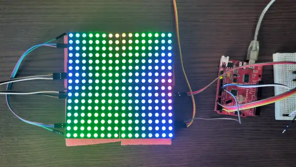
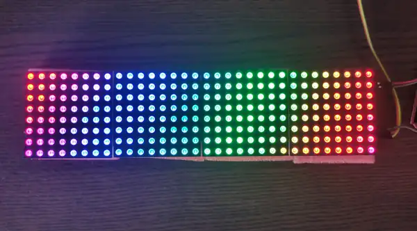

# rainbowduino-rs

[![CI][status-png]][status]

<p align="center"></p>

Rust code for the [Seeed Studio Rainbowduino 
v2.0](https://wiki.seeedstudio.com/Rainbowduino_LED_driver_platform-ATmega328/),
an ATmega328-based driver board for an 8x8 RGB LED matrix (3x MBI5168 
shift-register LED drivers), controlled over I2C:

- [`slave/`](slave/): the Rainbowduino firmware. It receives a full framebuffer 
  over I2C and displays it continuously, with 16 brightness levels (4 bits) per 
  color.
- [`display/`](display/): a library for the I2C master, to drive a display made 
  of several boards as a single one, in any arrangement (e.g. four boards as a 
  32x8 strip or a 16x16 square, with some boards upside down to simplify the 
  wiring).
- [`master/`](master/): an example master firmware for an Arduino Uno, using 
  the library.

## Hardware

- MCU: ATmega328 (same chip as the Arduino Uno/Diecimila), 16MHz
- 3x MBI5168 constant-current LED driver ICs (one per color channel), 
  bit-banged via a simple shift register protocol on PORTC
- I2C slave interface for receiving frame data from a master microcontroller

Multiple boards can be chained on a single shared I2C bus, each with its own 
address, to build a larger combined display.

## Wiring

Power the boards from a separate supply (9V recommanded) on their VCC/GND 
terminals. The bus needs pull-ups: 2x 2.2k resistors from SDA and SCL to 
the master's 5V. Without them, the master hangs on its first write. The 
master's GND must be wired to the boards' GND.

```text
                              Rainbowduino 0x08    Rainbowduino 0x09
                              +----------------+   +----------------+
              9V (+) ---------| VCC        VCC |---| VCC        VCC |-->
              9V (-) ---------| GND        GND |---| GND        GND |-->
                              |                |   |                |
Arduino Uno                   |                |   |                |  more
+----------------+            |                |   |                |  boards
|             5V |--+-----+   |                |   |                |  ...
|                | 2.2k  2.2k |                |   |                |
| USB        GND |--|-----|---| GND        GND |---| GND        GND |-->
|       A5 (SCL) |--|-----+---| SCL        SCL |---| SCL        SCL |-->
|       A4 (SDA) |--+---------| SDA        SDA |---| SDA        SDA |-->
+----------------+            +----------------+   +----------------+
```

## Protocol

Each board is an I2C slave at a configurable 7-bit address. A master writes one 
96-byte frame per transaction; the format is described in 
[`slave/src/frame.rs`](slave/src/frame.rs).

There is no read support. If a master tries to read from a board, it gets a 
single dummy byte with value 0.

## Performance

- I2C at 400 kHz: a board accepts about 280 frames/s without errors. With four 
  boards sent one after the other, that is about 70 full images/s.
- Display refresh: about 85 Hz, the best trade-off for colors: refreshing faster 
  would shorten the dwell times and blur the lowest brightness levels, 
  refreshing slower would make the display flicker.

## Flashing the Rainbowduino

The board has no USB port, so flashing needs a 5V FTDI/USB-serial adapter wired 
to its DTR/GND/TXD/RXD header (TX/RX crossed). See the board layout diagram in 
[`slave/src/main.rs`](slave/src/main.rs) for where these pins are.

Requires [nix](https://nixos.org/download/). Clone this repo, then from its 
root:

```sh
nix run .#flash-slave -- /dev/ttyUSB0      # flash with the default address 0x08
nix run .#flash-slave -- /dev/ttyUSB0 0x09 # or set RB_I2C_ADDR to 0x09 and flash in one step
```

Each physical board needs a distinct address before being wired onto a shared 
bus with others.

## Example master

The Rainbowduino is an I2C slave, so it needs a master to send it frames. 
`master/` contains example firmware for an Arduino Uno acting as the I2C 
master, using the library:

- [`master/src/bin/rainbow.rs`](master/src/bin/rainbow.rs): a scrolling 
  rainbow on four boards chained into a 32x8 strip.

  <p align="center"></p>

- [`master/src/bin/plasma.rs`](master/src/bin/plasma.rs): a plasma on a 16x16 
  square of four boards, the bottom two upside down ([the video at the 
  top](#rainbowduino-rs)).

```sh
nix run .#flash-master -- /dev/ttyUSB0 rainbow # the rainbow
nix run .#flash-master -- /dev/ttyUSB0 plasma  # the plasma
```

## Developing

Start a dev shell:

```sh
nix develop
```

From here, use `cargo build`/`cargo check` etc. as usual from `slave/`, 
`master/` or `display/`, or just keep using the scripts in [`scripts/`](scripts/) directly. 
The library's tests run on the host: `cd display && cargo test`.

## Other firmware

Other firmware for the Rainbowduino v2.0:

- [neophob/neorainbowduino](https://github.com/neophob/neorainbowduino): an 
  I2C-slave C firmware, plus a serial-to-I2C gateway sketch and a Processing 
  library.
- [rainbowduino-firmware](https://code.google.com/archive/p/rainbowduino-firmware/): 
  a higher-level command set over I2C (draw pixel/line/square, buffer swap, 
  text, scrolling).
- [mtXcontrol](https://github.com/rngtng/mtXcontrol): a Processing-based LED
  matrix editor, paired with its own firmware
  ([rainbow.ino](https://github.com/rngtng/rainbow.ino)).
- [rainbowdash](https://github.com/kreativekorp/rainbowdash): a more advanced 
  firmware with double-buffering and onboard animation, talks UART only, with a 
  companion desktop app (RainbowStudio).

[status-png]: https://github.com/jecaro/rainbowduino-rs/actions/workflows/ci.yml/badge.svg
[status]: https://github.com/jecaro/rainbowduino-rs/actions
